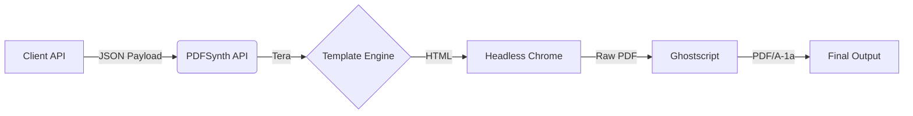

# ⚡ PDFSynth

PDFSynth is a high-performance, agnostic microservice designed to render PDF/A-1a compliant documents from HTML templates and JSON data.

Built by [Synth Solutions](https://www.synthsolutions.com.br/), it leverages the safety of Rust, the accuracy of Headless Chrome, and the robustness of Ghostscript to ensure your documents are perfectly rendered and archived forever.

## 🏗 Architecture

PDFSynth follows a clean "Input-Process-Output" architecture:



## 🚀 Features

- **Platform Agnostic**: Runs anywhere Docker runs (Kubernetes, AWS ECS, Azure, Google Cloud Run, DigitalOcean).
- **Stateless & Scalable**: No persistent state; scales horizontally instantly.
- **PDF/A Compliance**: Native support for ISO 19005-1 (PDF/A-1a) for long-term archiving.
- **Dynamic Templating**: Uses Tera (Jinja2-like syntax) for powerful logic.
- **Secure**: Runs as a non-root user; opt-in `options.secure` mode renders untrusted HTML without JavaScript or network access.
- **Logs**: template contents and data values are never logged (only sizes and key names).

## 🛠️ Usage

### Option 1: Run with Docker (Recommended)

You can pull and run the container directly from GitHub Container Registry:

```bash
# Pull the latest image
docker pull ghcr.io/jospnunes/pdfsynth:latest

# Run the container
docker run -p 8080:8080 --init ghcr.io/jospnunes/pdfsynth:latest
```

Or build locally:

```bash
# Build the image
docker build -t pdfsynth .

# Run the container
docker run -p 8080:8080 --init pdfsynth
```

### Option 2: Docker Compose

Easily integrate PDFSynth into your existing stack using `docker-compose.yml`:

```yaml
services:
  pdf-engine:
    image: ghcr.io/jospnunes/pdfsynth:latest
    ports:
      - "8080:8080"
    restart: always
    deploy:
      resources:
        limits:
          memory: 1G
```

## 🔌 API Reference

### POST /render

Generates a PDF based on the provided template and data.

**Request:**

```http
POST /render
Content-Type: application/json

{
  "template_html": "<html><body><h1>Certificate for {{ name }}</h1></body></html>",
  "data": {
    "name": "João Silva"
  },
  "options": {
    "pdf_a": true,        // Enables PDF/A conversion (slower but compliant)
    "paper_format": "A4", // A4, Letter, Legal
    "secure": false       // Optional, default false. true = hardened mode (see below)
  }
}
```

**Response:**

- `200 OK`: Binary PDF file.
- `400 Bad Request`: Template syntax error.
- `500 Internal Server Error`: Rendering engine failure.

#### `options.secure` (opt-in hardening for untrusted HTML)

`secure` is optional and defaults to `false`: with `false` the behavior is exactly the legacy one
(JavaScript on, external fonts/images/CSS over http(s) allowed). Nothing changes for callers that do not send it.

With `"secure": true` the document is rendered in a locked-down tab:

- **No JavaScript**: it is disabled in the tab (CDP `Emulation.setScriptExecutionDisabled`) before any content is loaded, so
  `<script>`, inline handlers (`onload`, `onerror`...) and `javascript:` URLs never run.
- **No network and no local files**: every request of the tab is intercepted (CDP `Fetch` domain) and only `data:` and `about:`
  URLs are allowed. `http:`, `https:`, `file:`, `ws:`, `chrome:`, `blob:` etc. fail (``,
  `<link rel=stylesheet>`, `<iframe src="file:///...">`, `<meta http-equiv=refresh>` and so on).
- **Resources only via `data:` URI**: CSS must be inline (`<style>` or `style=""`) and fonts/images must be embedded as `data:` URIs.
- **Timeout**: 15 s for CDP calls and for the load event.
- Because JavaScript is off, the "wait for images" script used by the legacy mode is replaced by waiting for the page `load` event
  (plus a short settle time).

**Template escaping:** Tera autoescape is **disabled** (for compatibility; the template is the HTML itself). Whoever calls the
API must HTML-escape the values in `data` that come from users (`&`, `<`, `>`, `"`, `'`) before sending them, or use
`secure: true` as a second line of defense when the template or the data may be untrusted.

### GET /health

Health check endpoint for load balancers and orchestrators (K8s probes).

```json
{"status": "ok"}
```

## 🧪 Tests

```bash
cargo test -- --nocapture
```

The browser tests (script not executed, `http://` image not requested, `file://` iframe not loaded, normal HTML still
renders, and legacy mode unchanged) need a Chromium at `/usr/bin/chromium` (or `chromium-browser`/`google-chrome`)
and `pdftotext` (poppler-utils). When either is missing they print `SKIPPED` and pass without running.

## ⚙️ Configuration

PDFSynth is configured via Environment Variables, following the 12-Factor App methodology.

| Variable | Default | Description |
|----------|---------|-------------|
| `PORT` | `8080` | The HTTP port the server listens on. |
| `RUST_LOG` | `info` | Log level (debug, info, warn, error). |

## 📦 Deployment Strategies

Since PDFSynth is packaged as a standard Docker container, it can be deployed to any provider:

- **Kubernetes (Helm/Kustomize)**: Define a Deployment and Service targeting port 8080.
- **AWS ECS / Fargate**: Push the image to ECR and run as a task definition.
- **Google Cloud Run**: Push to GCR/Artifact Registry and deploy as a managed service.
- **DigitalOcean App Platform**: Deploy directly from the container registry.

**Hardware Recommendation:**

- **Memory**: Minimum 1GiB RAM (Headless Chrome is memory intensive).
- **CPU**: 1 vCPU is sufficient for low to medium traffic.

⚖️ License

This project is licensed under the MIT License - see the LICENSE file for details.

Copyright © 2025 [Synth Solutions](https://www.synthsolutions.com.br/).